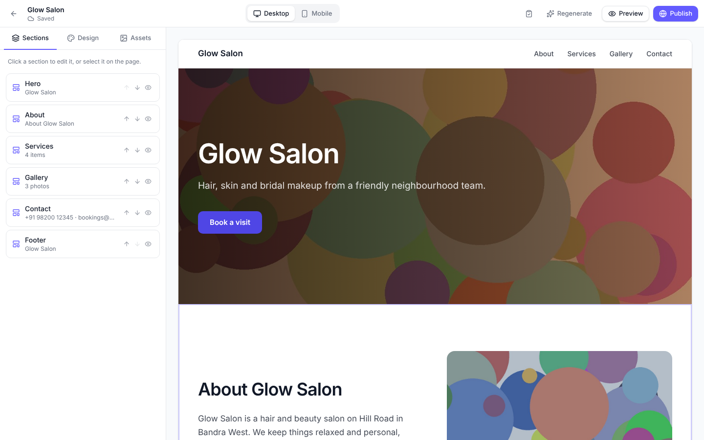
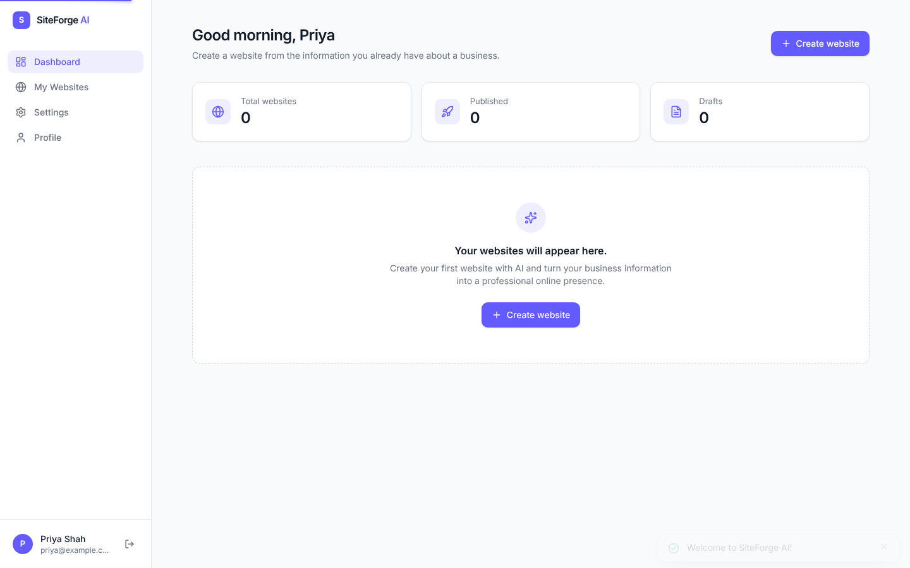
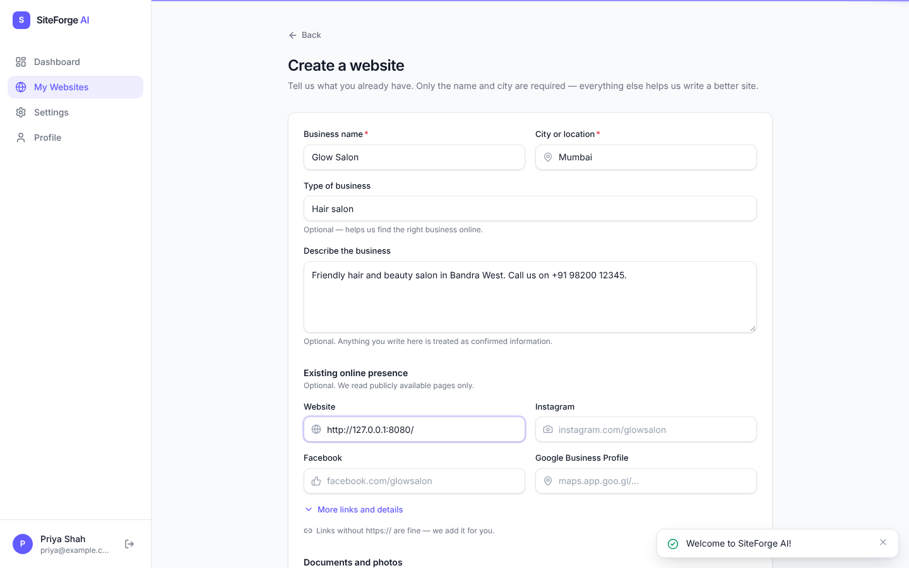
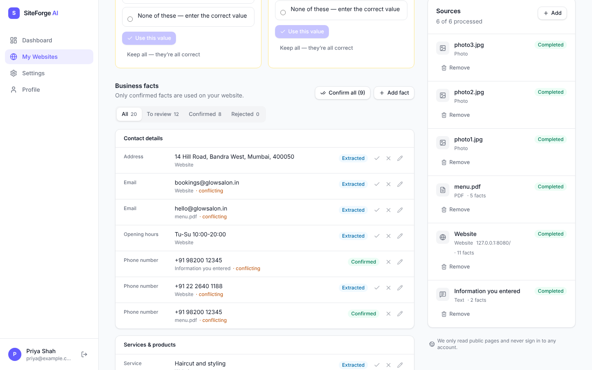
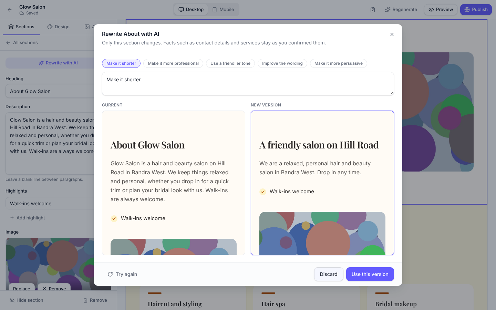
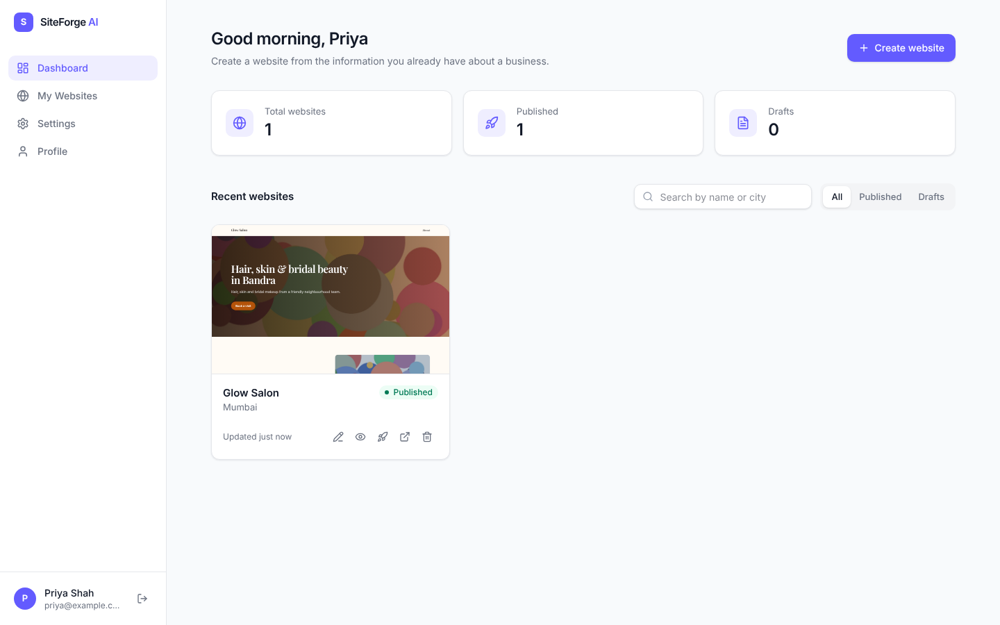

# SiteForge AI

**Turn your existing business information into a professional website with AI.**

SiteForge AI lets a small-business owner with no technical knowledge build a website from what they already have: a name and a city, their current website, social profiles, a Google Business Profile, PDF menus and brochures, price lists, and photos. The app reads these sources, pulls out business facts, flags facts that disagree, and lets the owner confirm them. It then uses Google Gemini to write a one-page website. Every part of the site can be edited, and the site can be published to a public URL.



---

## Contents

- [Features](#features)
- [Technology stack](#technology-stack)
- [Architecture](#architecture)
- [Requirements](#requirements)
- [Installation](#installation)
- [Environment variables](#environment-variables)
- [Gemini configuration](#gemini-configuration)
- [Search API configuration](#search-api-configuration)
- [File storage](#file-storage)
- [Queue setup](#queue-setup)
- [Running the application](#running-the-application)
- [Testing](#testing)
- [Deployment](#deployment)
- [Screenshots](#screenshots)

---

## Features

| Area | What works |
|---|---|
| **Accounts** | Register, log in, log out, password rules (8+ characters, a letter and a number), login rate limiting, profile and password changes, account deletion. |
| **Authorization** | Policies plus scoped route bindings, so no user can reach another user's businesses, sources, facts, images or websites. This is covered by tests. |
| **Dashboard** | Counts of total, published and draft websites; recent websites with *live* rendered thumbnails; search; status filters; edit, preview, publish and delete actions; the empty state from the brief. |
| **Businesses** | Create, view, edit and delete businesses. Several businesses per user, and several websites per business. Only the name and city are required. |
| **Uploads** | Drag and drop, multiple files, upload progress, extension *and* content-type checks, size limits, removing a file before upload, clear error messages. Images are re-encoded with GD to strip metadata and any hidden payload. |
| **Source processing** | Queued jobs with the statuses Pending, Processing, Completed, Failed and Blocked. PDF text extraction handles corrupt, empty, scanned and very large files. Website extraction reads JSON-LD, `tel:` and `mailto:` links, metadata and readable text, and follows up to three about/contact/services pages. Social and Google Business pages use public metadata only, and login walls are marked **Blocked** with the option to enter details manually. |
| **Web research** | Pluggable search providers (Serper or Google Programmable Search). **Identity resolution** scores each result on name, city, the owner's own links and known phone numbers. A same-name business elsewhere is never assumed to match: it is shown as "Is this your business?" and its page is not fetched until the owner confirms it. |
| **Facts** | Facts are extracted by rules (structured data and regex) and by AI. Every value the AI extracts must appear in the source text, or it is dropped. Statuses are Extracted, Needs review, Confirmed and Rejected, and facts can be edited, added by hand, confirmed in bulk and traced to their source. |
| **Conflicts** | Different phone numbers, emails, addresses, hours or names are detected after normalisation (`+91 98200-12345` equals `098200 12345`). Each value is shown with its sources. The owner chooses one, types the correct value, or keeps all values (phone and email only). The app never chooses on its own. |
| **AI website generation** | Gemini returns **structured JSON only**, which is validated against a schema. Contact details, the services list and images are filled in from confirmed facts, never from the model. Sentences with unsupported claims (awards, "20 years of experience", ratings, customer counts, guarantees and similar) are removed automatically. Malformed responses, rate limits, outages and invalid keys are handled with retries, and existing content is kept if generation fails. |
| **Basic mode** | Without a Gemini key, the site is still built from confirmed facts with neutral wording, and the UI labels it as built without AI. |
| **Website Studio** | Toolbar (name, save status, desktop/mobile, preview, publish), a Sections/Design/Assets panel and a live React canvas. Section actions: select (from the list or on the page), edit, hide, show, reorder, add, remove. Changes save automatically with Saving, Saved and Error states, and failed saves can be retried. |
| **Section regeneration** | Rewrite one section with optional instructions or presets (shorter, more professional, friendlier, and so on). The current and new versions are shown side by side, and nothing is saved until the owner clicks **Use this version**. Other sections are never touched. |
| **Design** | Three polished presets (Modern, Warm, Fresh); primary, secondary, background and text colours; three fonts; three button styles. Settings are validated on the server and stored as design tokens. |
| **Assets** | Upload, view, delete, use as the hero image, add to the gallery, and pick images inside section editors. Deleting an image removes every reference to it, including in published snapshots. |
| **Preview** | A full-page preview of the current content before publishing, with desktop and mobile views. |
| **Publishing** | Unique slugs (`/sites/glow-salon-mumbai`) with a live availability check, reserved words blocked and conflicts suffixed automatically. Publishing stores an **immutable snapshot**, so later edits go live only when you update the site. Includes a success dialog with copy link and view website, plus update and unpublish (the URL then returns 404 and the website stays in the dashboard). Server-rendered `<title>` and meta description. |
| **Renderer** | One set of React components (`HeroSection`, `AboutSection`, `ServicesSection`, `GallerySection`, `ContactSection`, `FooterSection`, `WebsiteRenderer`) powers the studio, previews, thumbnails and public sites. It never renders HTML from content. Container queries make the mobile preview accurate inside the editor. |

## Technology stack

- **Backend:** Laravel 12 (PHP 8.2+), Eloquent, form requests, policies, services, database queue
- **Frontend:** React 19, Inertia.js 2, TypeScript, Tailwind CSS 4, Lucide icons, Vite 7
- **Database:** MySQL 8 / MariaDB 10.6+ (SQLite is used for the fast test run)
- **AI:** Google Gemini `generateContent` REST API with JSON response schemas
- **PDF:** `smalot/pdfparser`
- **Search:** Serper.dev or Google Programmable Search (configurable)
- **Storage:** Laravel filesystem (local private disk by default, S3-compatible ready)

No Node backend, Docker, Redis or extra UI framework is required.

## Architecture

```
Browser (React + Inertia)
   │  pages/          Dashboard, Websites, Businesses, CreateWebsite, ResearchReview,
   │                  WebsiteStudio, Preview, PublicSite, Settings, Profile, Auth, Error
   │  components/     ui/ (design system), dashboard/, creation/, research/, studio/
   │  website-renderer/  the ONLY place websites are drawn (studio, preview, thumbnails, public)
   ▼
Laravel controllers (thin) ──► Services ──► Eloquent models ──► MySQL
                                  │
                                  ├─ Sources/   UrlGuard (SSRF), UrlFetcher, HtmlContentExtractor,
                                  │             PdfTextExtractor, SourceProcessingService, MediaService
                                  ├─ Research/  SearchProvider (Serper | Google CSE | None), IdentityResolver
                                  ├─ Facts/     RuleBasedFactExtractor, AiFactExtractor, FactGrounding,
                                  │             FactExtractionService, ConflictDetector, FactService
                                  ├─ Ai/        GeminiClient (retries, error mapping), PromptGuard
                                  └─ Websites/  WebsiteSchema (single validator), ClaimGuard, SiteAssembler,
                                                AiCopyWriter, BasicCopyWriter, WebsiteGenerationService,
                                                SectionRegenerationService, WebsiteService, PublishingService
Queue (database driver): ProcessSourceJob, ResearchBusinessJob, GenerateWebsiteJob
```

**How data flows:** form → `BusinessService` creates the business, its sources and a draft website → a queued job chain processes each source, then runs research → facts are stored with provenance → the owner reviews them on **Research Review** → `GenerateWebsiteJob` builds a `WebsiteContext` from *confirmed facts only*, Gemini writes the copy, `SiteAssembler` adds the deterministic facts, and `WebsiteSchema` validates everything → sections are saved in one transaction → the owner edits in the Studio (autosave as JSON) → `PublishingService` re-validates the content and stores a snapshot served at `/sites/{slug}`.

### Database

| Table | Purpose | Key relations |
|---|---|---|
| `users` | Accounts (plus `preferences` JSON) | has many `businesses` |
| `businesses` | Name, city, category, description, links, status, research status | belongs to user; has many sources, facts, media, websites |
| `sources` | One row per input (text, PDF, website, social, Google Business, image, search result): content, status, error, identity status, metadata | belongs to business; has many facts |
| `business_facts` | Key, value, normalised value, status, source, source type, extraction date | belongs to business and (nullable) source |
| `media` | Uploaded images (UUID, disk path, MIME type, size, dimensions, alt text) | belongs to business |
| `websites` | Slug (unique), theme JSON, status, generation status and error, published snapshot, content and published versions | belongs to business; has many sections |
| `website_sections` | Type, content JSON, position, visibility | belongs to website |
| `jobs`, `failed_jobs`, `cache`, `sessions` | Laravel defaults | — |

Every foreign key cascades or nulls on delete, and indexes cover the common lookups.

## Requirements

- PHP **8.2+** with the `pdo_mysql`, `mbstring`, `dom`, `fileinfo`, `gd` (with WebP support recommended) and `curl` extensions
- Composer 2
- Node.js **20+** and npm
- MySQL 8 or MariaDB 10.6+

## Installation

```bash
git clone <your-repo-url> siteforge && cd siteforge

composer install
cp .env.example .env
php artisan key:generate

# create the database first, e.g.:
#   CREATE DATABASE siteforge CHARACTER SET utf8mb4 COLLATE utf8mb4_unicode_ci;
# then set DB_* in .env and run:
php artisan migrate

npm install
npm run build        # or `npm run dev` while developing
```

## Environment variables

| Variable | Default | Meaning |
|---|---|---|
| `APP_URL` | — | Public base URL; public sites live at `{APP_URL}/sites/{slug}` |
| `DB_*` | — | MySQL connection |
| `QUEUE_CONNECTION` | `database` | Background jobs (keep `database`) |
| `AI_PROVIDER` | empty (auto) | `gemini` or `groq`. When empty: Gemini if its key is set, otherwise Groq |
| `GROQ_API_KEY` / `GROQ_MODEL` | empty / `llama-3.3-70b-versatile` | Use Groq for AI writing and fact extraction |
| `GEMINI_API_KEY` | empty | Enables AI writing and AI fact extraction with Gemini |
| `GEMINI_MODEL` | `gemini-2.5-flash` | Any Gemini model that supports JSON output |
| `GEMINI_TIMEOUT` / `GEMINI_RETRIES` | `60` / `2` | Request timeout (seconds) and retries for rate limits, outages and malformed JSON |
| `SEARCH_PROVIDER` | `none` | `none`, `serper` or `google_cse` |
| `SEARCH_API_KEY` | empty | Key for the chosen provider |
| `GOOGLE_CSE_ID` | empty | Search engine ID (Google CSE only) |
| `SEARCH_MAX_RESULTS` | `8` | Results per query |
| `SITEFORGE_MEDIA_DISK` | `local` | Filesystem disk for uploads |
| `SITEFORGE_MAX_UPLOAD_KB` | `10240` | Per-file upload limit |
| `SITEFORGE_FETCH_TIMEOUT` | `15` | Timeout for reading websites |
| `SITEFORGE_ALLOW_PRIVATE_HOSTS` | `false` | **Development only.** Allows fetching localhost and private-network URLs |

Secrets are only ever read from the environment and are never sent to the browser. `.env` is in `.gitignore`.

## AI configuration (Gemini or Groq)

**Groq:** create a key at <https://console.groq.com/keys>, set `GROQ_API_KEY=gsk_...` (optionally `GROQ_MODEL`), run `php artisan config:clear` and restart the queue worker. Groq runs in JSON mode with the expected schema in the system message, and the same validation, grounding and claim filtering apply.

**Gemini:**

1. Create a key at <https://aistudio.google.com/apikey>.
2. Set `GEMINI_API_KEY=...` in `.env`, and optionally `GEMINI_MODEL`.
3. Run `php artisan config:clear` and restart the queue worker.

**Settings → Integrations** shows whether Gemini is configured, without revealing the key. Without a key:

- Fact extraction uses rules only (structured data, `tel:` and `mailto:` links, phone and email patterns).
- Website generation runs in **basic mode** (neutral copy built from confirmed facts).
- "Rewrite with AI" is hidden, and the API returns a clear `not_configured` error.

## Search API configuration

Research is optional. Without it, the Research Review page says so plainly and the owner continues with their own information.

- **Serper** (simplest): get a key at <https://serper.dev>, then set `SEARCH_PROVIDER=serper` and `SEARCH_API_KEY=...`.
- **Google Programmable Search:** create an engine set to search the whole web, then set `SEARCH_PROVIDER=google_cse`, `SEARCH_API_KEY=<Google API key>` and `GOOGLE_CSE_ID=<cx>`.

Searches use the business name, the city and (when given) the category. Results are scored by `IdentityResolver`: strong matches are read in full, while possible same-name businesses wait for the owner's confirmation.

## File storage

Uploads go to `storage/app/private/businesses/{id}/…` on the `local` disk. **Nothing is served directly from storage.** Images are streamed by `GET /media/{uuid}`, which returns an image only to its owner, or to anyone when the image appears on a currently published site. PDFs are never served. To use S3 or another cloud disk, configure the disk in `config/filesystems.php` and set `SITEFORGE_MEDIA_DISK`.

## Queue setup

Source processing, research and website generation run as queued jobs on the `database` driver (the `jobs` table already exists after migrating).

```bash
php artisan queue:work --tries=2 --timeout=240
```

In production, keep the worker running with Supervisor (example below) and run `php artisan queue:restart` after each deploy. If no worker is running, the Research page shows a "Waiting for the background worker" warning instead of loading forever.

## Running the application

```bash
composer dev
# runs: php artisan serve + queue:listen + pail logs + vite (via concurrently)
```

Or run each part in its own terminal:

```bash
php artisan serve
php artisan queue:work
npm run dev
```

Open <http://127.0.0.1:8000>, register, and click **Create website**.

### Demonstrating with a real business

The app has no hard-coded businesses. For each one:

1. **Create website** → enter at least the name and city. Add whatever else exists: website, Instagram, a PDF menu or brochure, photos.
2. Wait on **Research Review** while the sources are read, then resolve any conflicts, confirm facts (or click **Confirm all**), and add anything missing.
3. **Generate website** → edit in the Studio → **Publish**, and share the `/sites/…` link.

## Testing

```bash
php artisan test                      # fast run on in-memory SQLite (configured in phpunit.xml)

# run the same suite against MySQL/MariaDB:
DB_CONNECTION=mysql DB_DATABASE=siteforge_test DB_USERNAME=... DB_PASSWORD=... php artisan test

npm run typecheck                     # TypeScript
npm run build                         # production bundle
```

All external HTTP (Gemini, search, websites) is faked in tests with `Http::fake()`, and stray requests fail the test. The suite has **57 tests and about 550 assertions**:

- Auth, rate limiting, profile and settings
- Cross-user authorization and scoped bindings
- Business CRUD and minimal input
- Upload validation (type, size, content sniffing)
- PDF (good, empty, corrupt) and website extraction, login-wall blocking, SSRF protection
- Research and identity resolution
- Fact confirmation and rejection, conflict detection and resolution
- Basic and AI generation, AI hallucination filtering, prompt-injection handling, malformed JSON, rate limits and invalid keys
- Section editing, sanitisation, reorder, add and remove, theme validation
- Regeneration proposals (not saved until accepted)
- Assets
- Publish snapshots, republish, unpublish, slug uniqueness, media visibility

## Deployment

The application is **prepared** for any Laravel-compatible host (Laravel Forge, Ploi, a VPS with Nginx and PHP-FPM, Laravel Cloud, cPanel with SSH). It has not been deployed from this repository. Steps:

1. Provision PHP 8.2+, MySQL, Nginx (document root: `public/`), Supervisor and Node (build step only).
2. Set production `.env` values: `APP_ENV=production`, `APP_DEBUG=false`, `APP_URL=https://your-domain`, `DB_*`, `GEMINI_API_KEY`, the search settings and `SESSION_SECURE_COOKIE=true`.
3. Deploy:
   ```bash
   composer install --no-dev --optimize-autoloader
   php artisan key:generate        # first deploy only
   php artisan migrate --force
   npm ci && npm run build
   php artisan config:cache && php artisan route:cache && php artisan view:cache
   php artisan queue:restart
   ```
4. Supervisor program for the worker:
   ```ini
   [program:siteforge-worker]
   command=php /var/www/siteforge/artisan queue:work --sleep=3 --tries=2 --timeout=240
   autostart=true
   autorestart=true
   user=www-data
   numprocs=1
   stopwaitsecs=260
   redirect_stderr=true
   stdout_logfile=/var/www/siteforge/storage/logs/worker.log
   ```
5. Make `storage/` and `bootstrap/cache/` writable by the web user.

When `APP_URL` starts with `https://`, the app forces HTTPS URLs.

## Screenshots

| | |
|---|---|
|  |  |
|  |  |
|  |  |

Published site: [docs/screenshots/10-public-site.png](docs/screenshots/10-public-site.png)

See [DECISIONS.md](DECISIONS.md) for design decisions, limitations and future work.
